# Fabric of the Game

## About

Fabric of the Game is a football shirt collecting and sharing website built using Django.

The aim of the project is to create a community where football shirt collectors can showcase their collections, discover shirts belonging to other collectors and share their passion for football shirts.

## Project Goals

The website aims to allow users to:

- Create an account and log in.
- Upload football shirts to their personal collection.
- Add multiple photographs of each shirt, including front, back and detail photographs.
- Provide information about each shirt, including team, season, manufacturer, country, league, shirt type, issue, size and condition.
- Add an optional player name and shirt number.
- Include a personal description of each shirt.
- Browse shirts uploaded by other collectors.
- View other users' public collections.
- Comment on other collectors' shirts.
- Edit and delete their own shirt listings.
- Search and filter shirts uploaded by the community.

## User Stories

The following user stories were created and recorded as GitHub Issues during the planning and development of Fabric of the Game. Each user story describes a feature of the website and includes acceptance criteria to explain what the feature should achieve.

### User Story 1 – Add Football Shirts to the Site with Pictures

**As a user, I can add football shirts to the site so that I can store them in my collection.**

**Acceptance Criteria:**
- Add a football shirt and have it stored in My Collection.
- Add a picture to the shirt post.
- Add information about the shirt, including team, year, condition and size.

**GitHub Issue Evidence:**

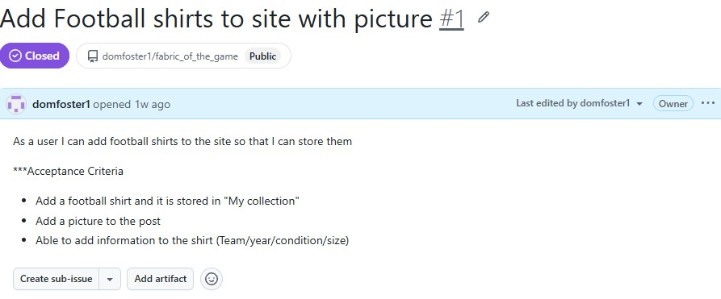

### User Story 2 – Filter Shirts

**As a user, I can filter shirts so that I can look at specific shirts.**

**Acceptance Criteria:**
- Add a filter section to the homepage and My Collection page.
- Provide buttons for users to select different filter options.
- Allow users to select multiple filter options.

**GitHub Issue Evidence:**

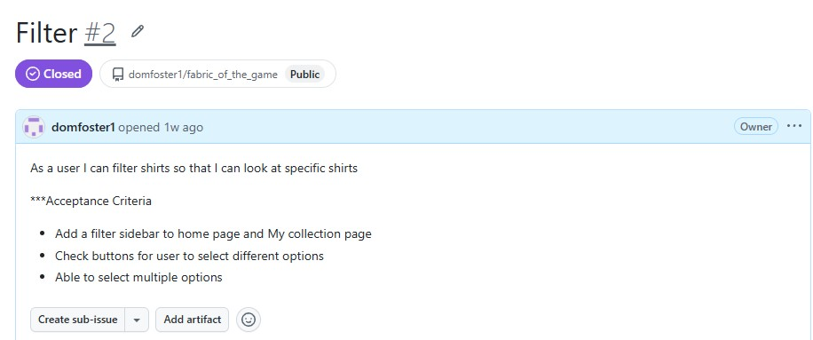

### User Story 3 – Display Posts from Different Users on the Homepage

**As a user, I can see posts from other users so that I can view their collections.**

**Acceptance Criteria:**
- Posts added by different users to My Collection are visible on the homepage.
- Display all the information included in the original shirt post.
- Allow users to comment on posts.

**GitHub Issue Evidence:**

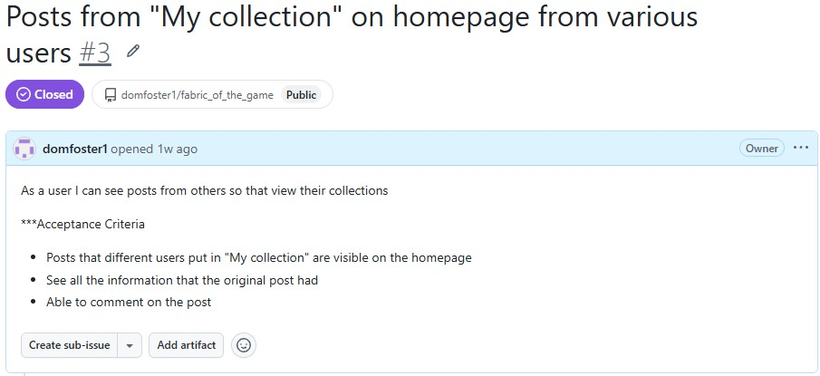

### User Story 4 – Edit and Delete Posts

**As a user, I can edit and delete posts so that I can change or remove them when necessary.**

**Acceptance Criteria:**
- Display Edit and Delete buttons only on the user's own posts in My Collection.
- Allow users to change shirt information.
- Allow users to delete their own posts.

**GitHub Issue Evidence:**

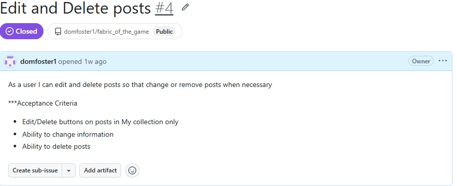

### User Story 5 – Account Registration

**As a user, I can register so that I can start posting my own football shirt collection and commenting on other users' posts.**

**Acceptance Criteria:**
- Allow users to register an account using an email address.
- Allow registered users to log in.
- Only allow users to post when logged in.
- Only allow users to comment when logged in.

**GitHub Issue Evidence:**

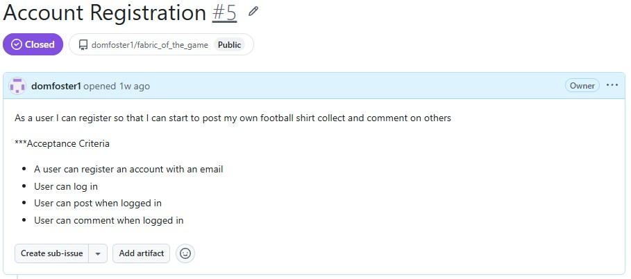

### User Story 6 – Approve or Reject Comments

**As a site administrator, I can approve or reject comments so that I can monitor comments and reject any unacceptable content.**

**Acceptance Criteria:**
- Allow the administrator to approve comments.
- Allow the administrator to reject comments.

**GitHub Issue Evidence:**

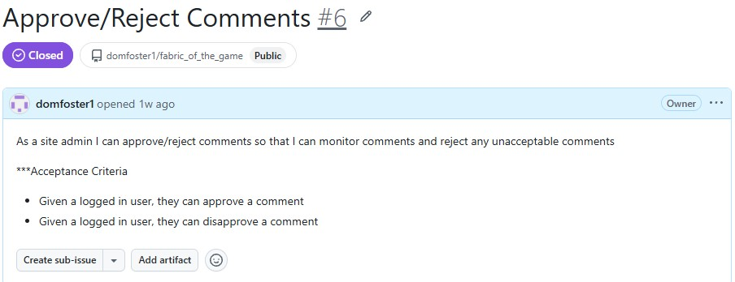

### User Story 7 – Edit or Delete a Comment

**As a user, I can edit or delete a comment so that I can retract a comment or correct mistakes.**

**Acceptance Criteria:**
- Allow logged-in users to edit their own comments.
- Allow logged-in users to delete their own comments.

**GitHub Issue Evidence:**

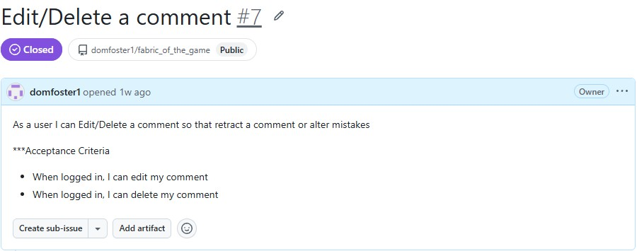

## Technologies Used

The project uses the following technologies:

- **Python** – Main programming language.
- **Django** – Web application framework.
- **django-countries** – Provides country information for the shirt submission form.
- **HTML** – Website structure.
- **CSS** – Custom website styling.
- **Bootstrap 5.3.8** – Responsive layouts and components.
- **JavaScript** – Used by Bootstrap for interactive website features.
- **SQLite** – Relational database.
- **Pillow** – Image handling.
- **Cloudinary** – Image hosting and storage.
- **Gunicorn** – Application server used for deployment.
- **Heroku** – Website hosting.
- **Git and GitHub** – Version control.
- **WhiteNoise** – Used to serve static files during deployment.

## Design

The website uses a football heritage-inspired design, with a focus on football shirt collections and bringing collectors together to share their passion for the game.

The layout is designed to make it easy for users to showcase their collections, discover shirts belonging to other collectors and explore the history behind different football shirts.

The colour scheme uses cream, navy, burgundy and white to create a traditional football collector feel.

## Wireframes

Wireframes were created during the planning stage to help visualise the layout and structure of Fabric of the Game on both laptop and mobile screens.

The finished website follows the original wireframe designs closely, with a few small changes made during development to improve the layout, appearance and user experience.

### Homepage

**Laptop view**

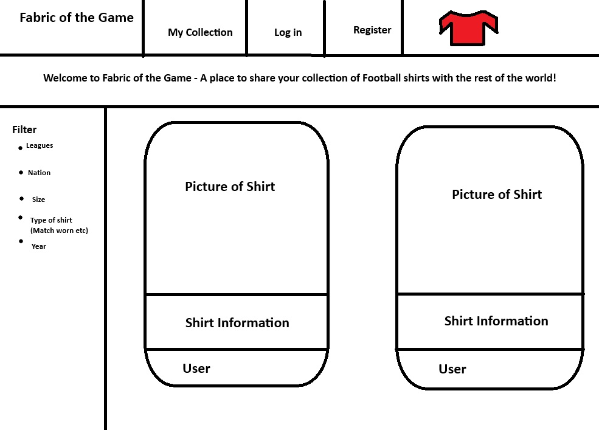

**Mobile view**

### Website layout

**Laptop view**

### My Collection

**Laptop view**

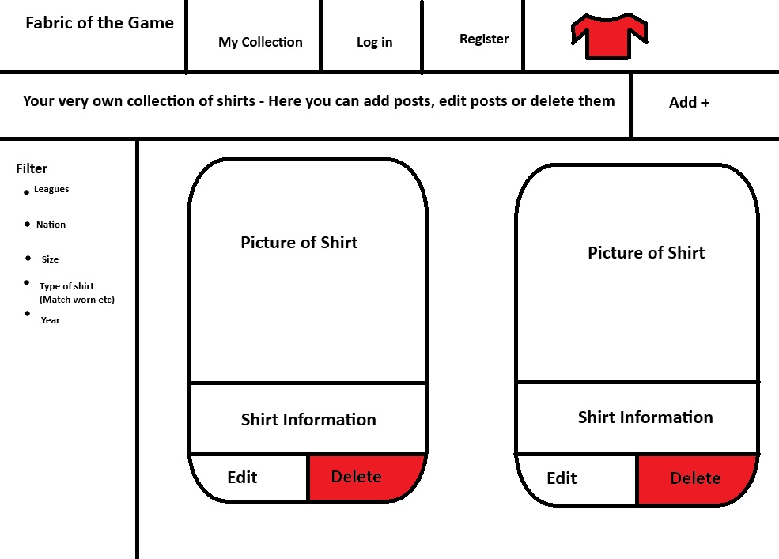

**Mobile view**

## Current Progress

- [x] Django project created.
- [x] Homepage created.
- [x] My Collection page created.
- [x] Shared base template created.
- [x] Bootstrap added.
- [x] Custom CSS stylesheet connected.
- [x] Initial Heroku deployment completed.
- [x] Shirt database model created.
- [x] Shirt image database model created.
- [x] Models registered in Django admin.
- [x] Shirt submission form created.
- [x] Add a Shirt page created.
- [x] Shirt submissions successfully saving to the database.
- [x] Shirts linked to the user who added them.
- [x] Login protection added to the Add a Shirt page.
- [x] User registration and login pages.
- [x] Display shirts in My Collection.
- [x] Multiple image uploads connected to the submission form.
- [x] Edit and delete shirt listings.
- [x] Ownership permissions for editing and deleting shirts.
- [x] Public user collections.
- [x] Homepage feed showing community uploads.
- [x] Usernames linked to public collections.
- [x] Manufacturer dropdown added.
- [x] Worldwide country dropdown added, with England, Scotland, Wales and Northern Ireland listed separately.
- [x] League dropdown added, including Japanese J1, J2 and J3 Leagues.
- [x] Optional player name and shirt number fields.
- [x] Search and filter shirts by team, season, manufacturer, country, league and player
- [x] Users can comment on shirts
- [x] Admin approval required before comments appear publicly
- [x] Cloudinary image hosting.
- [x] Users can edit and delete their own comments.
- [x] Login required to add shirts and comments.
- [x] Final responsive design.
- [x] Final deployment and testing.

## Deployment Notes

### Heroku deployment

The website is deployed using Heroku and connected to the project's GitHub repository.

The application uses environment variables to store sensitive settings, including the Django secret key and Cloudinary API credentials. These are configured through Heroku Config Vars and are not stored in the GitHub repository.

### Deployment Process

The following steps were used to deploy Fabric of the Game to Heroku:

1. The project was stored in a GitHub repository and the main branch was kept up to date with the latest changes.
2. A Heroku application was created and connected to the GitHub repository.
3. The required environment variables were added through Heroku Config Vars, including the Django secret key and Cloudinary credentials.
4. The application dependencies were recorded in `requirements.txt` so Heroku could install the required packages.
5. A `Procfile` was added to tell Heroku how to start the Django application using Gunicorn.
6. WhiteNoise was configured to serve static files in the deployed application.
7. The main branch was selected in the Heroku Deploy tab and deployed using Manual Deploy.
8. The live website was opened and tested to check that the application, user accounts, shirt listings and uploaded photographs worked correctly.

### Production Security

The Django application is configured with `DEBUG=False` in production to prevent detailed error information from being displayed to website visitors.

Sensitive information, including the Django secret key and Cloudinary API credentials, is stored in environment variables rather than directly in the project code. The local `.env` file is excluded from Git using `.gitignore`, helping to prevent these credentials from being uploaded to GitHub.

### Database

The project currently uses SQLite for its database. The `db.sqlite3` file is included in the repository to support the current deployment setup.

SQLite is suitable for this project during development, but a more permanent database solution would be recommended for a production website because Heroku's filesystem is not persistent.

### Image storage

Uploaded football shirt photographs are stored using Cloudinary. This allows images to remain available independently of Heroku's temporary filesystem.

Cloudinary has been configured locally and on Heroku, and image uploads and display have been tested successfully.

## Credits and Acknowledgements

- [Django](https://www.djangoproject.com/) – Web application framework.
- [Bootstrap 5.3.8](https://getbootstrap.com/) – Used for responsive layout and styling.
- [Cloudinary](https://cloudinary.com/) – Used for storing and displaying uploaded shirt photographs.
- [django-countries](https://pypi.org/project/django-countries/) – Used to provide country choices.
- [django-crispy-forms](https://django-crispy-forms.readthedocs.io/) and [crispy-bootstrap5](https://pypi.org/project/crispy-bootstrap5/) – Used for form rendering and Bootstrap styling.

## Manual Testing

Manual testing was carried out on Fabric of the Game to check that the website's main features work correctly. The tests covered user registration and login, shirt management, comments, search and filtering, permissions, image uploads and responsive design.

The following table shows the tests performed, the expected results and the actual results.

| Test | Action | Expected Result | Actual Result | Status |
|---|---|---|---|---|
| Register a new account | Enter valid registration details and submit the form. | A new account is created successfully. | The account was created successfully. | Pass |
| Log in | Enter a registered username and password and submit the form. | The user is logged in successfully. | Login was successful. | Pass |
| Log out | Click Logout and confirm by selecting OK. | The user is logged out successfully. | Logout was successful. | Pass |
| Incorrect login details | Enter a correct username with an incorrect password. | Login is rejected and an error message is displayed. | Login was rejected and an error message appeared. | Pass |
| Access My Collection when logged out | Log out and check the navbar, then try to access the My Collection page directly. | My Collection is hidden from the navbar and access is restricted to logged-in users. | My Collection was hidden from the navbar when logged out, and access was restricted. | Pass |
| Add a shirt | Complete the shirt form, upload a photograph and submit it. | The shirt is saved and appears in the user's collection. | The shirt was saved and appeared in the collection. | Pass |
| Edit a shirt | Open a shirt, change one detail and save the changes. | The updated shirt details are displayed. | The shirt details updated successfully. | Pass |
| Delete a shirt | Select Delete Shirt and confirm the deletion. | The shirt is deleted and no longer appears in the collection. | The shirt was deleted successfully and disappeared from the collection. | Pass |
| Cancel shirt deletion | Select Delete Shirt, then choose Cancel on the confirmation page. | The shirt remains in the collection. | The shirt remained in the collection after cancelling. | Pass |
| Upload multiple photographs | Add a shirt with two or more photographs. | All photographs are saved and displayed in the shirt's image carousel. | All photographs uploaded and displayed correctly. | Pass |
| Search for shirts | Enter a team name in the search box and click Search. | Shirts matching the search term are displayed. | Matching shirts were displayed successfully. | Pass |
| Filter shirts | Apply the available filters, including season and league. | Only shirts matching the selected filters are displayed. | All available filters worked correctly and displayed matching shirts. | Pass |
| Reset search and filters | Apply a search and filters, then click Reset. | Search and filter selections are cleared and all shirts are displayed again. | Search and filters cleared successfully, and all shirts appeared again. | Pass |
| Add a comment | Submit a comment on another user's shirt post. | The comment is submitted and awaits administrator approval before appearing publicly. | The comment was submitted successfully. | Pass |
| Approve a comment | Approve a pending comment through the Django admin area. | The approved comment appears publicly on the shirt post. | The comment was approved and appeared publicly. | Pass |
| Edit a comment | Select Edit Comment, change the text and save. | The updated comment is displayed. | The comment was edited successfully. | Pass |
| Delete a comment | Select Delete Comment and confirm the deletion. | The comment is deleted and no longer appears on the post. | The comment was deleted successfully. | Pass |
| View public collections | Log out and open another user's collection from the homepage. | The public collection can be viewed without logging in. | The collection was accessible while logged out. | Pass |
| Registration password validation | Enter different passwords in the password and confirmation fields. | Registration is rejected and an error message is displayed. | Registration was rejected and an error message appeared. | Pass |
| Duplicate username validation | Attempt to register using an existing username. | Registration is rejected and an error explains that the username is already taken. | Registration was rejected and the error message appeared. | Pass |
| Required shirt fields | Leave a required field empty when adding a shirt and submit the form. | The shirt is not saved and a validation message is displayed. | The shirt was not saved and a validation message appeared. | Pass |
| Mobile responsiveness | View the homepage, navigation bar and shirt cards using Chrome DevTools mobile view. | The layout adjusts to smaller screens without overlapping content or horizontal scrolling. | The website displayed correctly on a mobile-sized screen. | Pass |
| Tablet responsiveness | View the homepage, navigation bar and shirt cards at a tablet-sized viewport. | The layout adjusts correctly, and buttons and forms remain usable. | The website displayed correctly at tablet size. | Pass |
| Desktop responsiveness | View the homepage, My Collection and shirt cards at a desktop-sized viewport. | Content is properly spaced, readable and displayed correctly. | The website displayed correctly on a desktop screen. | Pass |
| Image persistence | Refresh a shirt page containing multiple photographs. | All photographs remain available and display correctly after refreshing. | All photographs remained available after refreshing the page. | Pass |
| Shirt ownership permissions | Log in as a different user and view another user's collection. | The user can view the shirt but cannot edit or delete it. | The shirt was visible, but editing and deleting options were unavailable. | Pass |
| Comment ownership permissions | Log in as a different user and view another user's comment. | The user cannot edit or delete another user's comment. | Edit and delete options were unavailable for another user's comment. | Pass |
| Direct access to another user's edit page | Attempt to open another user's shirt edit URL while logged in as a different user. | Access is denied or the user is redirected. | Access was restricted successfully. | Pass |

### Python Code Quality

The Python code was checked using Flake8 to identify and fix formatting issues, including unused imports, long lines, trailing whitespace and inconsistent spacing.

The project was also checked using Django's system check command. Both checks completed successfully with no remaining issues.

## HTML Validation

The website pages were checked using the W3C Markup Validation Service.

### Homepage

The initial validation found one heading structure error. The Search Shirts heading used an `<h3>` directly after an `<h1>`, skipping the `<h2>` level.

This was fixed by changing the Search Shirts heading to an `<h2>`.

**Initial validation – one error:**

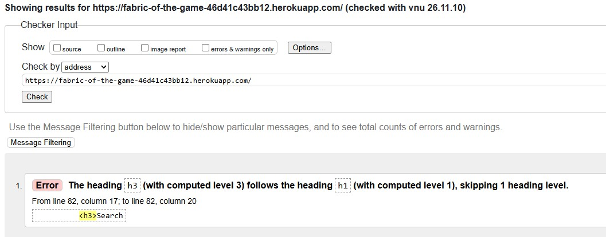

**Final validation – passed:**

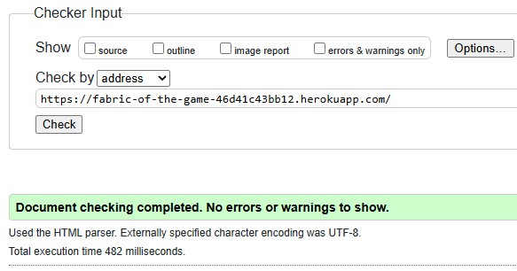

The homepage passed validation with no errors or warnings.

### Registration Page

The initial validation found five errors caused by unwanted Markdown code-fence text appearing before the DOCTYPE. This text was removed.

A further warning was fixed by changing the Create an Account heading from `<h3>` to `<h1 class="h3">`. This provided the correct heading structure while keeping the same visual size.

**Initial validation – five errors:**

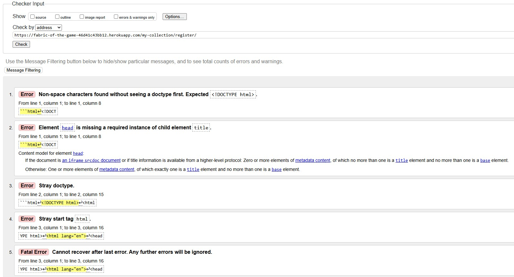

**Second validation – one warning remaining:**

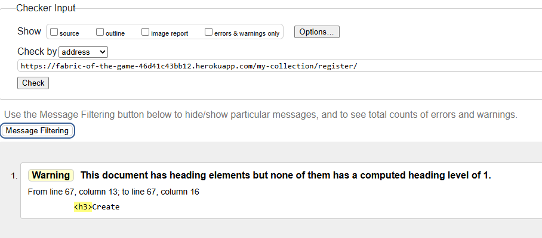

**Final validation – passed:**

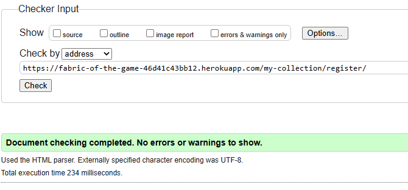

The registration page passed validation with no errors or warnings.

### Login Page

The initial validation found one warning because the page did not contain an `<h1>` heading. The Login heading used an `<h3>`.

This was fixed by changing the heading to `<h1 class="h3">`, providing the correct heading structure while keeping the same visual size.

**Initial validation – one warning:**

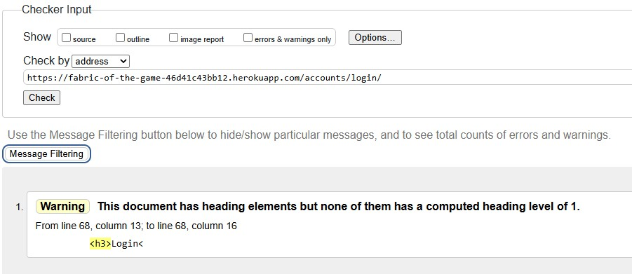

**Final validation – passed:**

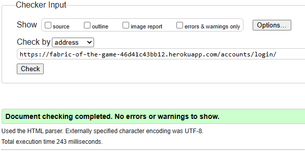

The login page passed validation with no errors or warnings.

### My Collection Page

The My Collection page was checked using the W3C Markup Validation Service.

**Final validation – passed:**

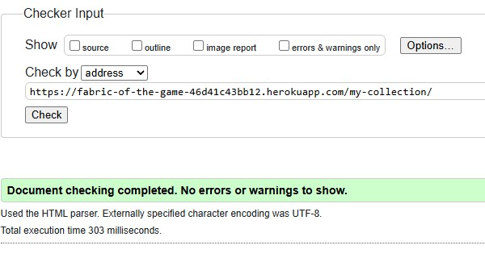

The My Collection page passed validation with no errors or warnings.

### Add a Shirt Page

The Add a Shirt page was checked using the W3C Markup Validation Service.

**Final validation – passed:**

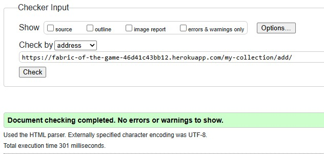

The Add a Shirt page passed validation with no errors or warnings.

### Edit Shirt Page

The Edit Shirt page was checked using the W3C Markup Validation Service.

**Final validation – passed:**

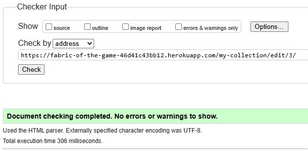

The Edit Shirt page passed validation with no errors or warnings.

### Public User Collection Page

The initial validation found one heading hierarchy error. The Search Shirts heading used an `<h3>` directly after an `<h1>`, skipping the `<h2>` level.

This was fixed by changing the heading to `<h2 class="h3">`, providing the correct heading structure while keeping the same visual size.

**Initial validation – one error:**

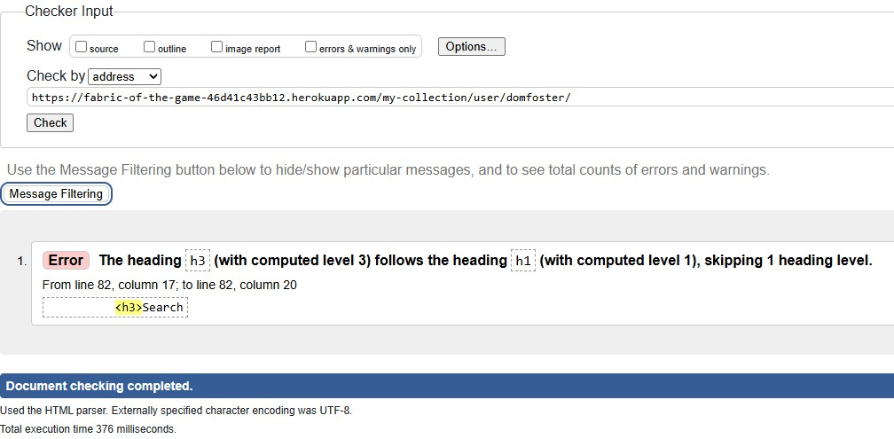

**Final validation – passed:**

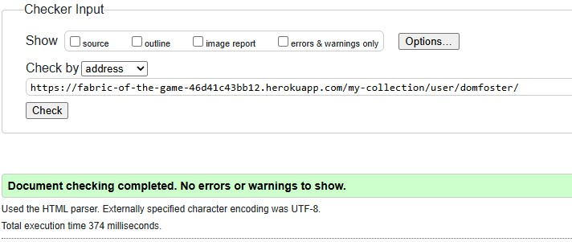

The Public User Collection page passed validation with no errors or warnings.

### Edit Comment Page

The Edit Comment page was checked using the W3C Markup Validation Service.

**Final validation – passed:**

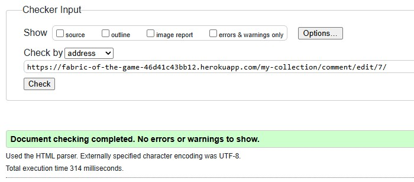

The Edit Comment page passed validation with no errors or warnings.

### Delete Comment Page

The Delete Comment page was checked using the W3C Markup Validation Service.

**Final validation – passed:**

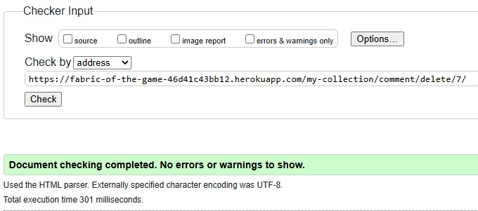

The Delete Comment page passed validation with no errors or warnings.

### Delete Shirt Page

The Delete Shirt page was checked using the W3C Markup Validation Service.

**Final validation – passed:**

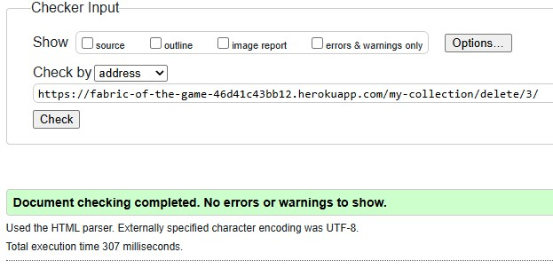

The Delete Shirt page passed validation with no errors or warnings.

## CSS Validation

The website's custom CSS stylesheet was checked using the W3C CSS Validation Service.

**Validation result – passed:**

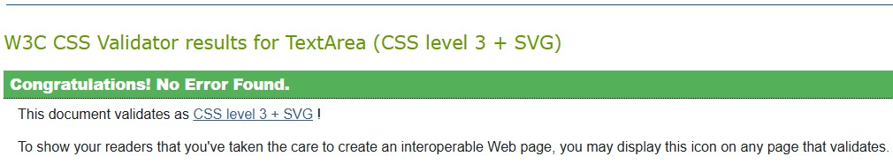

The stylesheet passed validation with no errors.

## Deployed Code and Link Checks

The deployed website was checked to make sure there was no unnecessary commented-out code and that internal links worked correctly.

The following checks were completed:

- Checked the project files for commented-out code. Only useful explanatory comments were retained.
- Tested the main navigation links.
- Tested links to public user collections.
- Tested shirt links and the Edit Shirt and Delete Shirt actions.
- Tested the Edit Comment and Delete Comment actions.

All tested links and actions worked correctly without producing broken links or 404 errors.